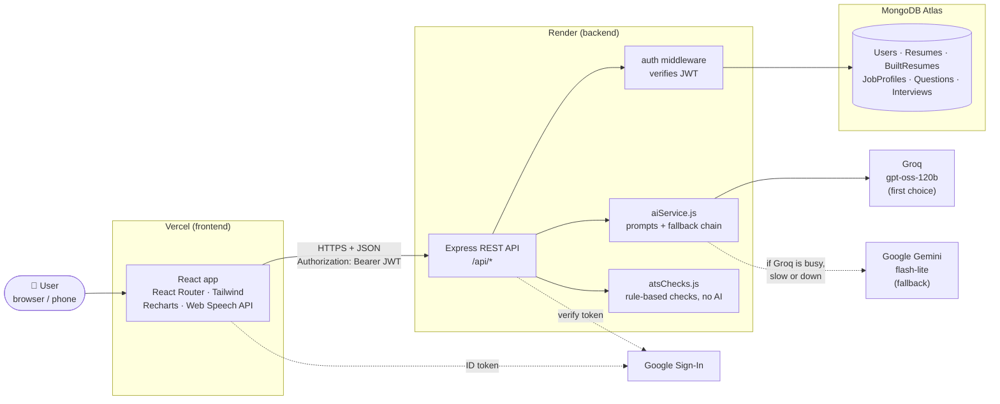
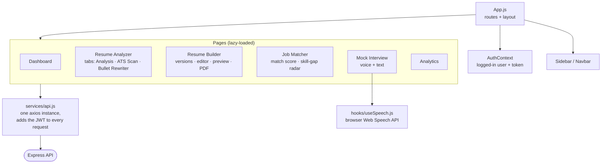
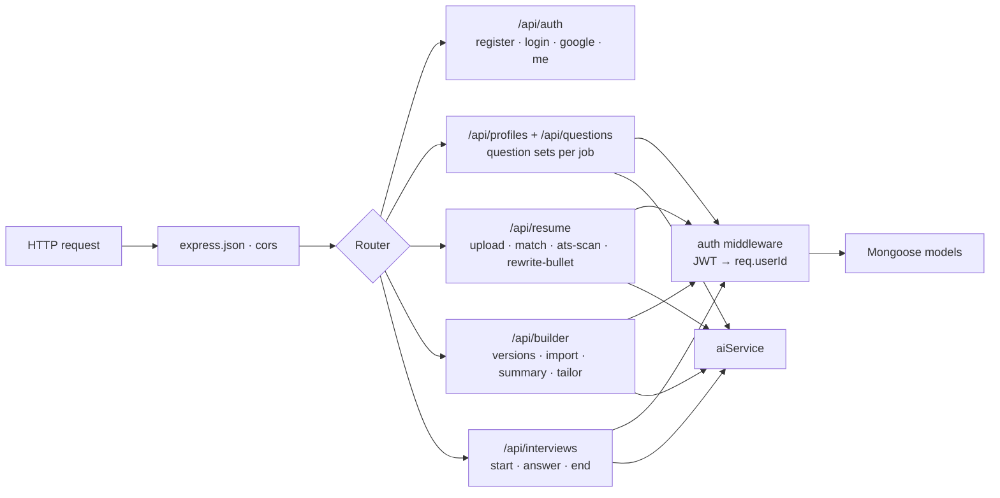
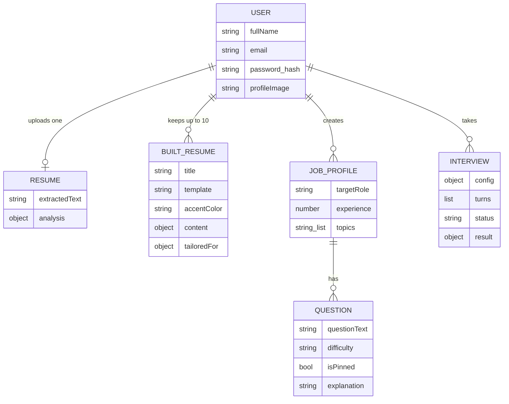
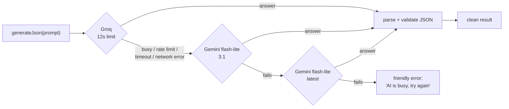
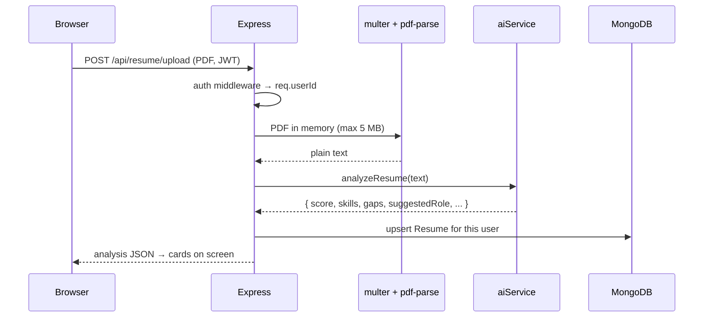
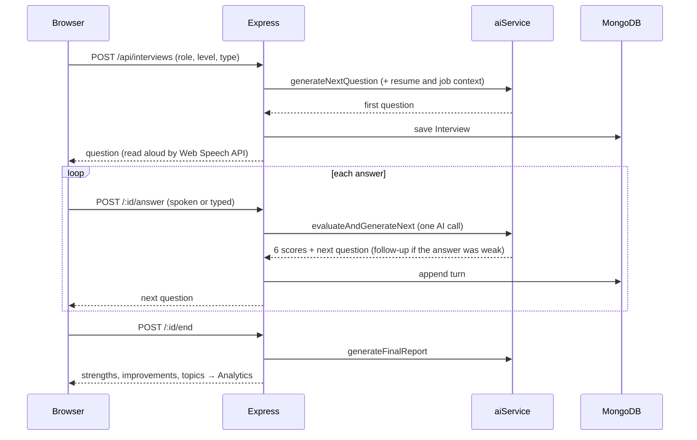
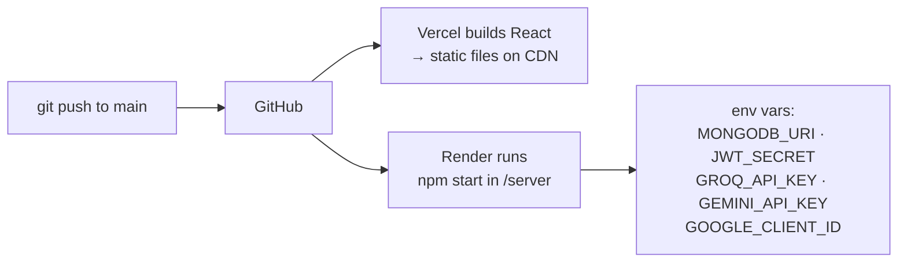

# Architecture

How InterviewPrep AI works, from the browser to the database and the AI providers.

## 1. The big picture

It is a standard **MERN** app split into two deployments, plus two outside AI services.

| Layer | Tech | Hosted on | Job |
|---|---|---|---|
| Frontend | React 18, React Router, Tailwind, Framer Motion, Recharts | Vercel | Pages, forms, charts, voice, PDF print |
| Backend | Node.js, Express | Render (free plan) | REST API, auth, file upload, talks to AI and DB |
| Database | MongoDB + Mongoose | MongoDB Atlas | Stores users, resumes, interviews |
| AI | Groq first, Gemini as fallback | External APIs | Scoring, matching, rewriting, interview questions |

## 2. Frontend

- **One API file.** Every request goes through `services/api.js`. It adds the JWT from `localStorage`, so pages never handle tokens themselves.
- **Lazy loading.** Heavy pages (charts, builder) are split out of the main bundle, so the dashboard loads fast.
- **Voice is free.** Speech-to-text and text-to-speech use the browser's built-in Web Speech API, with no paid service.
- **PDF without a library.** The builder renders the resume into a hidden copy and calls `window.print()`. Print CSS hides everything else. The browser's "Save as PDF" keeps real, selectable text, which is what an ATS needs.

## 3. Backend

Every route except register, login and Google sign-in is protected. The `auth` middleware checks the JWT and puts the user's id on `req.userId`. **Every database query filters by that id**, so one user can never read another user's data.

### Data model

- **Resume** = the one PDF a user uploaded: its text and the AI analysis.
- **BuiltResume** = a resume made in the builder. There can be many versions (one per job type), each with its own template and color.

## 4. How the AI layer works

All prompts live in one file, `server/utils/aiService.js`. Every prompt asks for **JSON back**, so the server can validate it field by field (numbers clamped to 0–100, unknown fields dropped) before anything reaches the database or the screen.

**Why two providers?** Everything runs on free tiers. Groq is fast (1–4 s) but has a per-minute token cap. Gemini sometimes stalls or runs out of quota. Trying the next provider on failure keeps the app working when one of them is having a bad day. Long jobs (importing or tailoring a whole resume) get a longer limit of 25 s per try.

### Rules the AI cannot break (enforced in code, not just in the prompt)

| Feature | Guard |
|---|---|
| Bullet Rewriter, AI summary, Tailoring | Any number in the AI's text that is not in your original becomes `<X>`, so invented metrics never reach your resume |
| Tailor to a job | The AI only returns summary, bullets and an ordering. Code copies those onto your resume, so names, companies, dates and education can't change, and no new skill can be added |
| ATS Scan | Half the score comes from plain code checks (contact info, headings, columns, length, numbers, icons). The same resume always gets the same format score |

## 5. Request walk-throughs

### Resume upload and analysis

### Adaptive mock interview

Grading the answer and choosing the next question happen in **one** AI call instead of two. That halves the wait between questions.

## 6. Feature map

| Page | Main endpoints | AI used for |
|---|---|---|
| Resume Analyzer → Analysis | `POST /resume/upload` | score, skills, gaps, suggested role |
| Resume Analyzer → ATS Scan | `POST /resume/ats-scan` | keywords and section feedback (plus code-based format checks) |
| Resume Analyzer → Bullet Rewriter | `POST /resume/rewrite-bullet` | 3 rewrite styles |
| Resume Builder | `/builder` CRUD, `/import`, `/summary`, `/:id/tailor` | import PDF into sections, summary, tailoring to a JD |
| Job Matcher | `POST /resume/match` | match score, section scores, skill gap, learning plan |
| Mock Interview | `/interviews` start · answer · end | questions, scoring, follow-ups, final report |
| Dashboard / Questions | `/profiles`, `/questions` | question sets and explanations |
| Analytics | `GET /interviews` | none (charts from saved scores) |

## 7. Deployment

- Secrets live only in Render's environment variables, never in the code or the frontend.
- The Render free plan sleeps after about 15 idle minutes. The frontend pings `/api/health` when the landing page opens, so the server is already waking up while the visitor reads.

## 8. Design decisions worth knowing

- **Monolith, not microservices.** One Express server is easy to run, deploy and explain at this size.
- **JWT, not sessions.** The server stays stateless, so it doesn't need a session store.
- **The AI returns JSON, and code checks it.** The model is treated like any other untrusted input.
- **Rule-based where possible.** ATS format checks and the number guard are plain code. They are fast, free and repeatable, and the AI is used only where language understanding is needed.
- **Free-tier aware.** Prompts trim long inputs to stay under token limits, and there are timeouts, provider fallback and a server warm-up ping.
